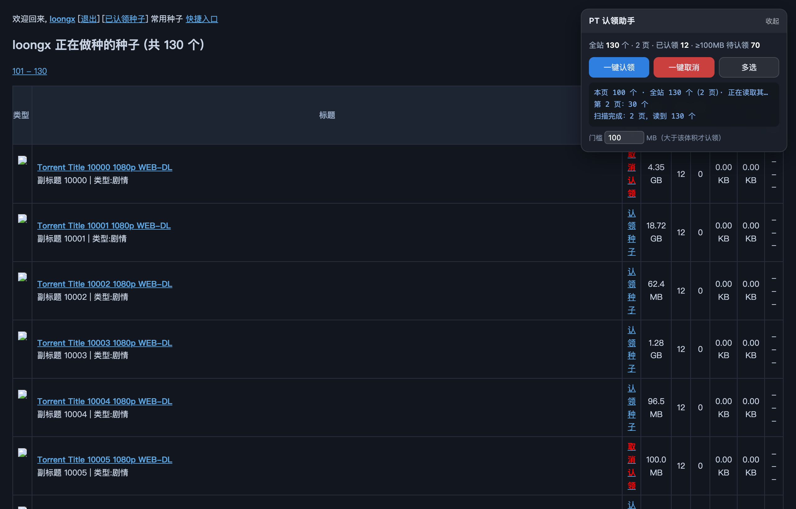
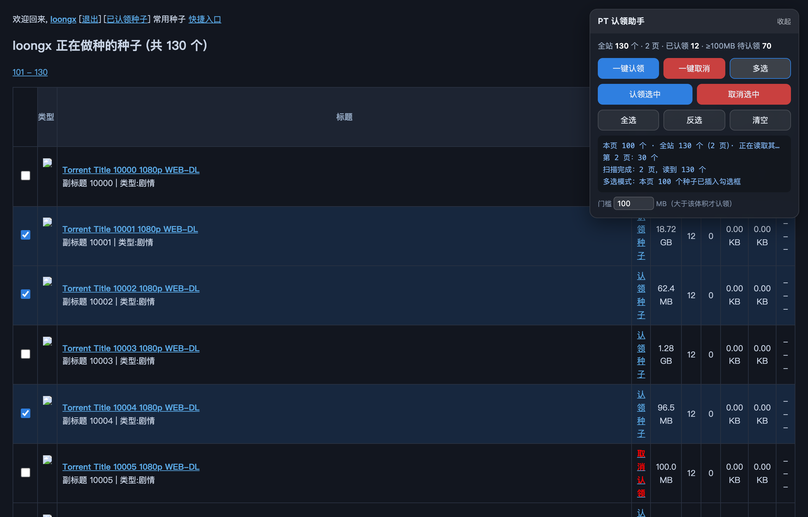
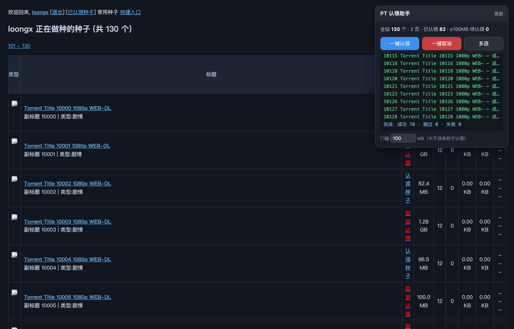

# PT 种子认领助手

一个 Tampermonkey / Violentmonkey 用户脚本，给 [pterclub.net](https://pterclub.net) 的做种列表页加一个浮动面板：**一键认领全部符合条件的种子、一键取消全部认领、勾选本页部分种子批量操作**。

省掉的是「一个种子点两下、翻页再点一百下」这种事。



---

## 功能

| 按钮 | 作用范围 | 行为 |
| --- | --- | --- |
| **一键认领** | 全站（跨所有分页） | 认领所有 **体积 > 门槛**（默认 100MB）且**尚未认领**的种子。已认领跳过、体积不足跳过、体积读不到跳过 |
| **一键取消** | 全站（跨所有分页） | 取消所有**已认领**的种子 |
| **多选** | 仅当前页 | 每行前面插入勾选框，勾选后可「认领选中 / 取消选中」，另有全选 / 反选 / 清空 |

几个配套细节：

- **执行前有确认弹窗**，列出「将认领 N 个 / 跳过 M 个」的明细，不会点一下就闷头跑
- **执行中可中断**：认领按钮变成「停止」，随时刹车
- **逐条日志**：成功 / 跳过 / 失败三色分开，出问题一眼定位
- **门槛可现场改**：面板底部输入框，改完立即对下一次操作生效
- **面板可拖动**：按住标题栏拖走，免得挡住右边的「操作」列；点标题栏折叠
- **请求节流**：每个请求间隔 320ms + 0~220ms 随机抖动，避免触发风控
- **撞到上限自动停**：服务端返回「认领上限 / 无权限」类错误时立即中断，不硬刷



---

## 安装

1. 浏览器装 [Tampermonkey](https://www.tampermonkey.net/)（或 Violentmonkey）
2. 点这里安装：[**pterclub-claim-helper.user.js**](https://raw.githubusercontent.com/flveboy/pterclub-claim-helper/main/pterclub-claim-helper.user.js)

   Tampermonkey 会识别 `.user.js` 后缀并弹出安装页，点「安装」即可。

   > 手动方式：Tampermonkey 图标 → 添加新脚本 → 全选删掉默认内容 → 粘贴本仓库 `pterclub-claim-helper.user.js` 全文 → `Ctrl/Cmd + S` 保存。

3. 打开做种列表页（`getusertorrentlist.php?userid=...&type=seeding`），右上角出现面板。

脚本匹配的页面：

```
https://pterclub.net/getusertorrentlist.php*
https://www.pterclub.net/getusertorrentlist.php*
```

---

## 使用

### 一键认领

1. 打开做种列表页，等面板统计行从「正在扫描…」变成正常数字（会后台抓其他分页）
2. 需要的话改一下门槛（默认 100 MB）
3. 点「一键认领」→ 看确认弹窗里的明细 → 确定
4. 日志逐条滚动，结束给一行汇总：`完成：成功 70 · 跳过 41 · 失败 0`

### 一键取消

红色按钮，同样有确认弹窗。**注意：取消认领后如果没人做种，种子可能被系统删除**，弹窗里也写了这句。

### 多选

点「多选」→ 每行前面出现勾选框、整行高亮 → 勾完点「认领选中」或「取消选中」。再点一次「多选」退出，勾选框和表头一起还原。



---

## 统计行怎么读

```
全站 130 个 · 2 页 · 已认领 12 · ≥100MB 待认领 70
```

- **全站 N 个**：以页面标题里那句 `正在做种的种子 (共 130 个)` 为准，不是"实际读到的行数"
- 万一分页读不全，会变成 `全站 130 个 · 2 页 · 已读 100`（红字），点操作前还会弹窗拦一下确认
- **已认领 / 待认领**：按行内的认领按钮状态实时统计

---

## 工作原理

脚本不写死页面结构，而是把**行内的认领按钮**当作唯一可靠锚点：

```html
<a href="#" data-url="viewclaims.php?in_modal=yes&do_ajax=1&add_torrent_id=891957"
   class="claim-confirm">认领种子</a>
<a href="#" data-url="viewclaims.php?in_modal=yes&do_ajax=1&del_torrent_id=900870"
   class="remove-confirm">取消认领</a>
```

- 每行恰好一个这样的按钮 → 有按钮的才是种子行，导航行 / 嵌套表格的外层行自动排除
- 从 `data-url` 里取 `add_torrent_id` / `del_torrent_id` 拿到种子 ID
- 按钮的 class 就是认领状态，不用猜文本

认领请求打的是 `viewclaims.php?do_ajax=1&add_torrent_id=<id>`（去掉 `in_modal=yes`）。返回值做了三层兜底：JSON（`{"ret":0}`）→ 返回了确认表单就自动提交 → 再退到文本关键词匹配。

跨页读取时如果 `fetch` 被站点 WAF 拦（返回 403 或错误页），会**自动改用隐藏 iframe 做真实页面导航**重试 —— iframe 带完整浏览器请求头，能过大多数 WAF。

更细的实现说明、DOM 结构、踩过的坑都在 **[docs/技术细节.md](docs/技术细节.md)**。

---

## 目录结构

```
.
├── pterclub-claim-helper.user.js   # 主脚本（单文件，无构建，直接安装）
├── docs/
│   └── 技术细节.md                  # 实现说明：DOM 结构、接口、解析策略、已知限制
├── test/
│   ├── mock_server.py              # 本地 NexusPHP 风格做种列表 mock（含 WAF 拦截开关）
│   ├── run_test.js                 # 自动化测试（puppeteer 驱动，20 项断言）
│   ├── shot.js                     # 生成文档截图
│   ├── analyze.js                  # 分析真实页面结构的辅助脚本
│   ├── _env.js                     # 解析 puppeteer / Chrome 路径
│   └── shots/                      # 截图
├── package.json
├── LICENSE
└── README.md
```

---

## 本地测试

不需要登录真实站点 —— 仓库自带一个 mock 的做种列表页，结构和真实页面一致（130 个种子 / 2 页 / 12 个已认领 / 带导航干扰行 / 各种体积边界值）。

```bash
# 1. 装依赖（只用到 puppeteer-core，复用系统已装的 Chrome）
npm install

# 2. 起 mock 服务（默认 127.0.0.1:18865，可用 MOCK_PORT 改）
npm run mock

# 3. 另开一个终端跑测试
npm run test
```

预期输出 20 行 `PASS`。测试覆盖：

- 跨页扫描：130 个种子 / 2 页 / 12 个已认领
- 体积门槛边界：100.0 MB **不**认领、100.1 MB 认领、96.5 MB 不认领
- 已认领的种子被判为「跳过」而不是「失败」
- 一键认领发出 70 个请求，不多不少
- 一键取消只针对已认领的 12 个
- 认领成功后行内按钮翻面成「取消认领」
- 多选只处理勾选行，退出后表头还原
- **WAF 拦截场景**：`fetch` 返回 403 时 iframe 兜底仍能读到全部 130 个

截图：`npm run shots`。

Chrome 路径找不到时，设 `CHROME_PATH` 环境变量指过去；`puppeteer-core` 装在别处时设 `PUPPETEER_PATH`。

---

## 常见问题

**面板没出现？**
确认脚本已启用、页面地址是 `getusertorrentlist.php`。按 `F12` 看控制台有没有 `[PT认领助手]` 开头的日志。

**统计数字不对 / 显示「已读 100」？**
说明有分页没读到。把日志里 `第 2 页：...` 那几行发出来。脚本已经内置 iframe 兜底，如果还失败，多半是分页参数或站点结构变了。

**点了一键认领，日志全是「无法判断返回」？**
说明接口返回的格式和预期都不一样。把日志里那段返回内容发出来，照着补一层判断。

**会不会被封号？**
请求间隔 320~600ms，走的是页面同源接口，和你手点按钮没区别。但**批量操作本身有风险**，站点如果有认领数量上限，脚本撞到会自动停。自己评估。

---

## 免责声明

本脚本仅用于简化自己账号的重复点击操作，不改动站点数据、不绕过权限、不共享账号。

使用前请确认符合目标站点的规则。**因批量操作导致的任何账号处罚或数据损失，作者不承担责任。** 尤其「一键取消」——取消认领后没人做种的种子可能被系统清理。

---

## License

[MIT](LICENSE)
